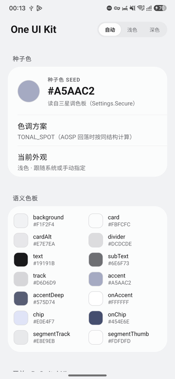
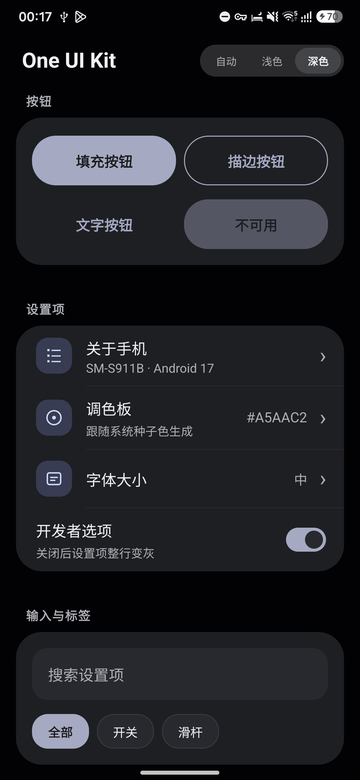
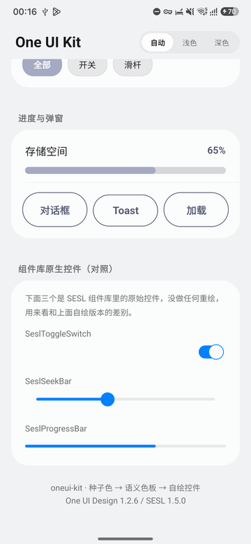

# One UI Kit

[](LICENSE)
[](https://developer.android.com/about/versions/12)
[](https://kotlinlang.org)
[](https://developer.android.com/build)
[](https://github.com/OneUIProject/oneui-design)

面向 Android 的 One UI 风格视图组件库。库从系统调色板读取种子色，生成完整的语义色板，并以该色板驱动一组重绘的交互控件；实现不依赖三星私有 API。

本项目在 [OneUIProject/oneui-design](https://github.com/OneUIProject/oneui-design) 及其配套核心库的基础上优化与整理而成，上游组件通过 Maven 依赖引入，详细关系见[与上游项目的关系](docs/upstream.md)。

本仓库为自包含的独立 Gradle 工程，包含 Android Library 模块与组件预览应用，可单独构建、发布 AAR 并安装预览应用。

> 当前实现为实验性版本，公开 API 尚未稳定。

## 预览

| 浅色 · 语义色板 | 深色 · 控件 | SESL 原生控件对照 |
| --- | --- | --- |
|  |  |  |

截图取自仓库内的 `sample` 应用。

## 项目来源

| 项目     | 说明                                                                                                                                                        |
| ------ | --------------------------------------------------------------------------------------------------------------------------------------------------------- |
| 上游仓库   | [OneUIProject/oneui-design](https://github.com/OneUIProject/oneui-design) 与 [OneUIProject/oneui-core](https://github.com/OneUIProject/oneui-core)，均采用 MIT 许可 |
| 沿用内容   | `OneUITheme` 主题基线、SESL 控件基类与触觉常量、上游 Maven 制品                                                                                                        |
| 本仓库实现  | Kotlin 语义色板、两个自绘控件、控件工厂、`sample` 预览应用、文档与构建配置                                                                                                     |
| 工程关系   | 独立 Gradle 工程，不包含上游源码副本；上游制品在构建时从 Maven 仓库解析                                                                                                     |

本仓库最初基于上游项目进行优化与整理，随后重构为独立发布的组件库。上游版权声明与 MIT 许可全文保留于 [NOTICE](NOTICE) 与[第三方许可证](THIRD_PARTY_LICENSES.md)；本仓库整体同样采用 MIT 许可，与上游保持一致。版本基线、改造范围与上游同步策略见[与上游项目的关系](docs/upstream.md)。

## 特性

- 从 `Settings.Secure` 解析三星系统调色板的种子色；在非三星设备上回落至 AOSP Monet 强调色，无法取得色位时回落至内置固定配色。
- 依据 CIELAB 明度表生成深浅两套语义色板，控件颜色全部由 `OneUiPalette` 注入。
- 提供 `BoSwitchView`（胶囊轨道开关）与 `DragOnlySeekBar`（仅响应横向拖拽的滑杆），包含状态补间、分级吸附与触觉反馈。
- 纯 Kotlin 视图实现，不调用三星私有 API，兼容 Android 12 及以上。
- 随仓库提供 `sample` 应用，用于验证色板、控件状态、深浅外观与嵌套滚动行为。

## 支持环境

| 项目                  | 要求                                                 |
| ------------------- | -------------------------------------------------- |
| 最低系统版本              | Android 12（API 31）                                 |
| 编译 SDK              | API 35                                             |
| 语言与运行时              | Kotlin 2.4.0，JDK 17                                |
| 构建环境                | Gradle 8.11.1、Android Gradle Plugin 8.7.3          |
| 主题基线                | `OneUITheme`（由 `io.github.oneuiproject:design` 提供） |
| 三星 One UI 4 及以上     | 读取系统选中的种子色，结果与系统设置一致                               |
| 其他 Android 12 及以上设备 | 回落至 AOSP Monet 强调色，表面色结构保持本库定义                     |
| Android 11 及以下      | 回落至内置固定配色                                          |

## 模块

| 模块           | 类型                   | 说明                                                    |
| ------------ | -------------------- | ----------------------------------------------------- |
| `:oneui-kit` | Android Library      | 色彩系统与控件实现，发布为 `dev.pascal.oneuikit:oneui-kit:1.0.0` |
| `:sample`    | Android Application  | 组件预览应用，applicationId 为 `dev.pascal.oneuikit.sample`    |

库模块内部按职责分为三层。

| 层级 | 文件                                                               | 职责                            |
| -- | ---------------------------------------------------------------- | ----------------------------- |
| 色彩 | `oneui-kit/src/main/java/dev/pascal/oneuikit/MonetTones.kt`   | 种子色解析、CIELAB 色空间转换、语义色生成      |
| 色彩 | `oneui-kit/src/main/java/dev/pascal/oneuikit/OneUiPalette.kt` | 深浅两套语义色板的对外类型与固定配色回落          |
| 控件 | `oneui-kit/src/main/java/dev/pascal/oneuikit/BoSwitchView.kt` | 胶囊轨道开关                        |
| 控件 | `oneui-kit/src/main/java/dev/pascal/oneuikit/DragOnlySeekBar.kt` | 仅响应横向拖拽的滑杆                 |
| 工厂 | `oneui-kit/src/main/java/dev/pascal/oneuikit/OneUiWidgets.kt` | 将色板注入控件并绑定回调                  |

依赖方向为 `MonetTones` → `OneUiPalette` → `OneUiWidgets` → 控件实现。控件不直接读取系统设置，颜色全部由 `OneUiPalette` 注入。

## 组件一览

| 组件                | 基类               | 说明                                      |
| ----------------- | ---------------- | --------------------------------------- |
| `OneUiPalette`    | —                | 语义色板，包含深浅两套色值与固定配色回落                    |
| `MonetTones`      | —                | 种子色解析工具与语义色生成结果                         |
| `BoSwitchView`    | `CompoundButton` | 胶囊轨道、内嵌圆钮、状态补间与确认震动                     |
| `DragOnlySeekBar` | `SeslSeekBar`    | 粗轨道、空心环拇指、增量拖拽与分级吸附                     |
| `OneUiWidgets`    | —                | 控件工厂，提供 `switchView()` 与 `sliderView()` |

完整规格与参数说明见 [控件参考](docs/components.md)。

## 接入

发布制品坐标为 `dev.pascal.oneuikit:oneui-kit:1.0.0`。消费方声明依赖：

```kotlin
dependencies {
    implementation("dev.pascal.oneuikit:oneui-kit:1.0.0")
}
```

| 方式     | 配置                                                        | 适用场景                     |
| ------ | --------------------------------------------------------- | ------------------------ |
| 仓库制品   | 执行 `publishToMavenLocal` 或发布至 Maven 仓库，在消费方仓库列表中加入对应源      | 版本化集成                    |
| 复合构建   | 在消费方 `settings.gradle.kts` 中声明 `includeBuild("../OneUIKit")` | 源码联调，依赖坐标自动替换为本地库模块      |
| 源码模块   | 将 `oneui-kit/` 复制至消费方工程并注册 `include(":oneui-kit")`          | 不启用复合构建的工程               |

库通过 `api` 暴露 SESL 组件依赖，消费方无需重复声明。SESL 分支提供与 AndroidX 同包同名的类，需排除官方同名依赖以避免重复类冲突；主题必须继承 `OneUITheme`，否则 SESL 控件无法取得默认样式。完整配置、主题与色板刷新方式见 [接入指南](docs/getting-started.md)。

## 快速开始

```kotlin
val palette = OneUiPalette(context)
val widgets = OneUiWidgets(context, palette)

row.addView(
    widgets.switchView(checked = config.enabled) { enabled ->
        config = config.copy(enabled = enabled)
    }
)

column.addView(
    widgets.sliderView(
        value = config.size,
        max = 100,
        onLive = { value -> label.text = "$value%" },
        onCommit = { value -> config = config.copy(size = value) },
    )
)
```

`onLive` 在拖动过程中持续回调，用于刷新界面显示；`onCommit` 在拖拽结束后回调，用于持久化配置。

## 构建

构建需要 JDK 17、Android SDK Platform 35 与 Build Tools 35.0.1。通过 `ANDROID_HOME` 环境变量指定 SDK 路径，或在工程根创建 `local.properties` 并写入 `sdk.dir=<SDK 路径>`；后者不纳入版本管理。

```bash
./gradlew :oneui-kit:assembleDebug
./gradlew :sample:assembleDebug
./gradlew :oneui-kit:publishToMavenLocal
```

AAR 产物位于 `oneui-kit/build/outputs/aar/`，预览应用 APK 位于 `sample/build/outputs/apk/debug/`。仓库包含 GitHub Actions 工作流，推送至 `main` 分支或提交拉取请求时自动构建库与预览应用。

## 文档

| 文档                                  | 内容                               |
| ----------------------------------- | -------------------------------- |
| [接入指南](docs/getting-started.md)     | 依赖坐标、接入方式、主题、色板刷新与深浅模式         |
| [色彩系统](docs/palette.md)             | 种子色来源、取值优先级、CIELAB 明度表、实测基准与核验方法 |
| [控件参考](docs/components.md)          | 公开 API、绘制规格、手势状态机与实现约束         |
| [与上游项目的关系](docs/upstream.md)      | 版本基线、沿用与改造范围、许可证关系、上游同步策略      |
| [更新日志](CHANGELOG.md)               | 版本变更记录                           |
| [贡献指南](CONTRIBUTING.md)             | 构建环境、常用命令与变更约束                 |
| [第三方许可证](THIRD_PARTY_LICENSES.md)  | 上游组件版权声明与许可证全文                   |

## 已知限制

- `DragOnlySeekBar` 继承 `SeslSeekBar`；不使用 SESL 组件库时，将基类替换为 `AppCompatSeekBar` 即可，触摸与绘制逻辑无需修改。
- 触觉反馈使用 `HapticFeedbackConstants` 的 SESL 常量，在非三星设备上可能退化为常规震动或无反馈。
- 色彩计算基于 CIELAB 而非 HCT，高彩度蓝紫区间存在轻微色偏；替换 `labToColor()` 为 CAM16 实现可提升精度，接口保持不变。
- 固定明度表对应当前 One UI 版本的设计语言，系统大版本更新后需重新采样标定。
- SESL 组件的版本已锁定，升级后需对开关与滑杆之外的控件外观重新验证。
- One UI 3 及以下不提供 `theme_customization_overlay_packages`，取色链路自动回落。

## 许可证

本仓库整体采用 [MIT License](LICENSE)，与上游项目保持一致。上游 [oneui-design](https://github.com/OneUIProject/oneui-design) 与 [oneui-core](https://github.com/OneUIProject/oneui-core) 的版权声明与许可全文保留于 [NOTICE](NOTICE) 与[第三方许可证](THIRD_PARTY_LICENSES.md)。SESL 组件底层派生自 Android Jetpack 与 Material Components for Android，二者采用 Apache License 2.0，其条款仅适用于对应组件。上游 AAR 不随仓库分发，构建时从 Maven 仓库解析。

One UI 是 Samsung Electronics Co., Ltd. 的商标。本项目为非官方实现，与三星电子无隶属、授权或认可关系。
